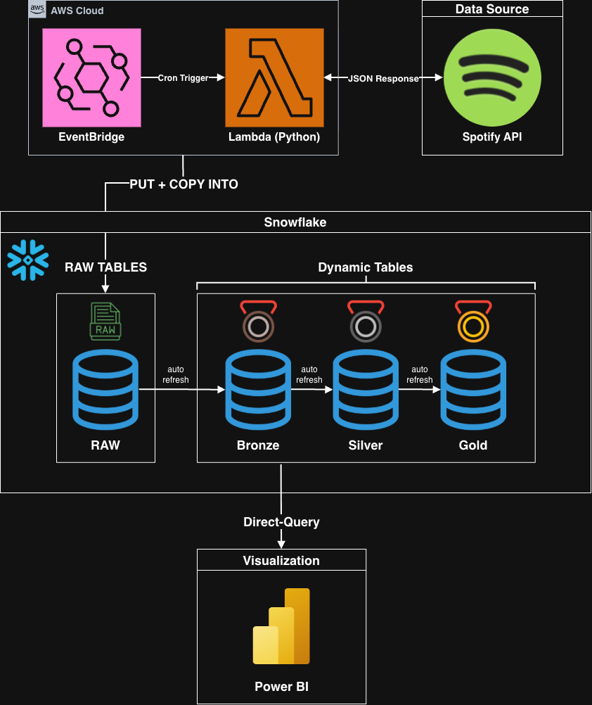

# Spotify ELT Pipeline - AWS Lambda, Eventbridge and Snowflake

An automated ELT pipeline that extracts data from the Spotify Web API for 10 indie/rock artists, loads raw JSON into Snowflake, and transforms it through a medallion architecture (Bronze/Silver/Gold) using Dynamic Tables. The Gold layer feeds a Power BI dashboard via DirectQuery.



## Pipeline Overview

```
Spotify API  →  AWS Lambda  →  Snowflake (RAW → Bronze → Silver → Gold)  →  Power BI
```

**Extract**: A Python Lambda function calls the Spotify API for each artist, fetching artist metadata, albums (paginated), and tracks per album (paginated). It handles rate limiting, incremental loading (skips albums already in Snowflake), and times out before the Lambda deadline.

**Load**: The Lambda writes JSON arrays to Snowflake's internal stage via `PUT`, then runs `COPY INTO` targeting only the files just uploaded. `STRIP_OUTER_ARRAY` on the file format ensures each JSON object becomes one row.

**Transform**: Eight Dynamic Tables handle all transformation:

| Layer | Table | Description |
|-------|-------|-------------|
| Bronze | `DT_ARTISTS` | Parse artist JSON: id, name, genres, followers, image URL |
| Bronze | `DT_ALBUMS` | Parse album JSON: id, name, type, release date, track count |
| Bronze | `DT_TRACKS` | Parse track JSON: id, name, duration, explicit flag |
| Silver | `DT_TRACKS_ENRICHED` | Join tracks + artists + albums; add `duration_display` (mm:ss), `release_year` |
| Silver | `DT_ALBUMS_ENRICHED` | Join albums + artists; add `release_year` |
| Gold | `DT_ARTIST_OVERVIEW` | Per-artist aggregates: track/album counts, duration stats, image URL |
| Gold | `DT_TOP_TRACKS_RANKED` | All tracks with single-version tagging and per-artist ranking |
| Gold | `DT_ALBUM_ANALYTICS` | All albums ranked by recency (overall and per-artist) |

Bronze and Silver use `TARGET_LAG = DOWNSTREAM` (only refresh when Gold needs them). Gold uses `TARGET_LAG = '1 hour'`.

## 10 Artists

1. Geese
2. Maruja
3. Fontaines D.C.
4. Wednesday
5. Magdalena Bay
6. Black Country New Road
7. Big Thief
8. Wolf Alice
9. The Last Dinner Party
10. MJ Lenderman

~2,200 tracks across ~550 albums/singles.

## Setup

### 1. Snowflake

Run the SQL scripts in order against your Snowflake account:

```bash
# Using SnowSQL or any SQL client
snowsql -f snowflake/01_setup.sql
snowsql -f snowflake/02_bronze.sql
snowsql -f snowflake/03_silver.sql
snowsql -f snowflake/04_gold.sql
```

This creates `MUSIC_DB` with four schemas, an internal stage, a JSON file format, three raw tables, and eight Dynamic Tables.

### 2. Lambda Deployment

1. Create a Lambda function (Python 3.12, 512 MB, 300-900s timeout)
2. Add a Lambda layer with `snowflake-connector-python`
3. Upload `lambda/lambda_function.py` as the function code
4. Set environment variables (see below)
5. Add an EventBridge trigger for your preferred schedule (e.g., daily at 6 AM UTC)

### 3. Environment Variables

| Variable | Required | Description |
|----------|----------|-------------|
| `SPOTIFY_CLIENT_ID` | Yes | From [Spotify Developer Dashboard](https://developer.spotify.com/dashboard) |
| `SPOTIFY_CLIENT_SECRET` | Yes | From Spotify Developer Dashboard |
| `SNOWFLAKE_ACCOUNT` | Yes | Account identifier (e.g., `MYORG-MYACCOUNT`) |
| `SNOWFLAKE_USER` | Yes | Snowflake username |
| `SNOWFLAKE_PASSWORD` | Yes | Snowflake password |
| `SNOWFLAKE_DATABASE` | No | Default: `MUSIC_DB` |
| `SNOWFLAKE_SCHEMA` | No | Default: `RAW` |
| `SNOWFLAKE_WAREHOUSE` | No | Default: `COMPUTE_WH` |

### 4. Local Testing

```bash
cd lambda
pip install -r requirements.txt

# Set env vars, then run:
python lambda_function.py --local
```

Local mode writes JSON backup files to disk and optionally uploads to Snowflake (skipped if `SNOWFLAKE_PASSWORD` is not set).

## Key Design Decisions

- **Incremental loading**: Lambda queries Snowflake for known album IDs before fetching. Only new albums and their tracks are downloaded and loaded, reducing API calls and avoiding duplicates.
- **Album deduplication**: Spotify often returns multiple versions of the same album (deluxe, remaster). The Lambda deduplicates by album name per artist.
- **Single version tagging**: The Gold layer detects tracks that exist on both an album and a single release, appending "(Single Version)" to the single's name for clarity in dashboards.
- **Graceful timeout**: Lambda tracks remaining execution time and stops fetching before the deadline. Partially completed runs still upload what they have; the next run picks up the rest.
- **No external dependencies in Lambda**: Uses only `urllib` (stdlib) for Spotify API calls and `snowflake-connector-python` (Lambda layer) for Snowflake. No `requests`, no `spotipy`.

## Power BI

Connect Power BI Desktop to the Gold schema via the Snowflake connector:

- **Server**: `<your-account>.snowflakecomputing.com`
- **Warehouse**: `COMPUTE_WH`
- **Database**: `MUSIC_DB`
- **Schema**: `GOLD`

Use DirectQuery mode for live dashboards. Set `ARTIST_IMAGE_URL` data category to "Image URL" for the artist slicer.

## Project Structure

```
spotify-pipeline/
├── README.md
├── .gitignore
├── .env.example
├── lambda/
│   ├── lambda_function.py
│   └── requirements.txt
├── snowflake/
│   ├── 01_setup.sql
│   ├── 02_bronze.sql
│   ├── 03_silver.sql
│   └── 04_gold.sql
└── docs/
    ├── architecture.html
    └── architecture.png
```
